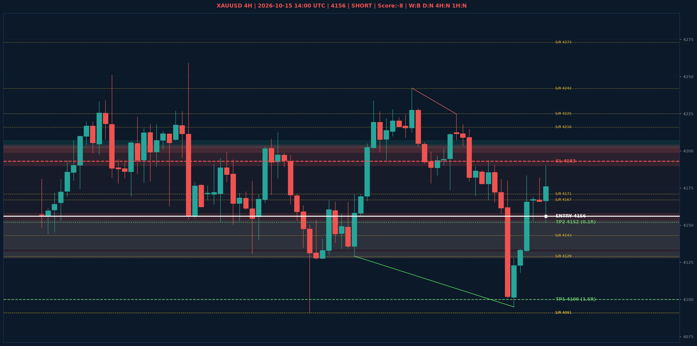

# XAUUSD Liquidity Sweep Analyse - 2026-10-15 14:00 UTC

> Prijs: 4156 | Beslissing: SHORT | Score: -8

---

## Liquidity Sweep

- **Manipulatie:** BEARISH @ 4182
- **5m reversal (BOS/iFVG):** bevestigd (iFVG: BEARISH)
- **1m entry trigger:** bevestigd
- **DXY 5m trend:** BULLISH | **Correlatie:** OK
- **Draws on liquidity (highs):** [4169.0, 4182.0, 4190.0, 4194.0]
- **Draws on liquidity (lows):** [4095.0, 4152.0, 4153.0, 4165.0]

---

## Grafiek

---

## Top-Down Trend

| TF | Trend |
|---|---|
| Weekly | BEARISH |
| Daily | NEUTRAAL |
| 4H | NEUTRAAL |
| 1H | NEUTRAAL |
| 30min | NEUTRAAL |
| 5min | NEUTRAAL |

## Fibonacci (swing 3955 - 4755)

| Level | Prijs |
|---|---|
| 23.6% | 4566 |
| 38.2% | 4450 |
| 50.0% | 4355 |
| 61.8% | 4261 |
| 78.6% | 4127 |

## S/R

Daily: [4091.0, 4143.0, 4171.0, 4216.0, 4273.0, 4329.0, 4440.0, 4755.0]
4H: [4091.0, 4129.0, 4167.0, 4225.0, 4242.0]
1H: [4095.0, 4153.0, 4167.0, 4180.0, 4194.0]

## Trade Setup

| | |
|---|---|
| Entry | 4156 |
| Stop Loss | 4193 |
| TP1 | 4100 (1.5R) |
| TP2 | 4152 (0.1R) |

*MVR Trading Agent | 2026-10-15 14:00 UTC*
