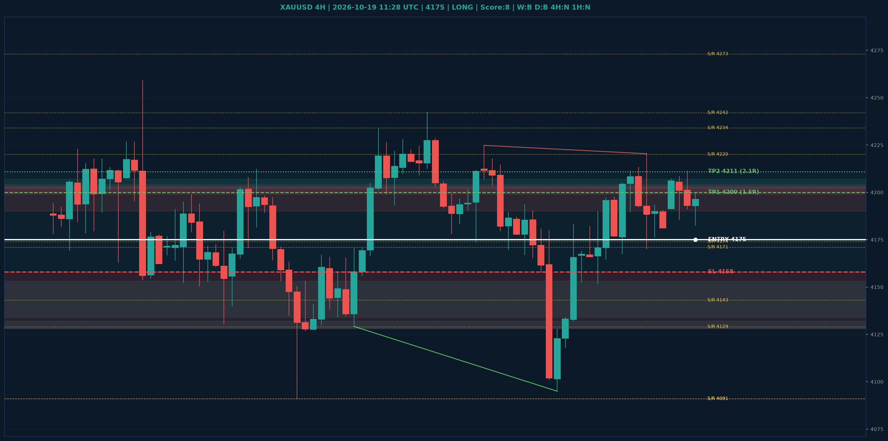

# XAUUSD Liquidity Sweep Analyse - 2026-10-19 11:28 UTC

> Prijs: 4175 | Beslissing: LONG | Score: 8

---

## Liquidity Sweep

- **Manipulatie:** BULLISH @ 4191
- **5m reversal (BOS/iFVG):** bevestigd (iFVG: BULLISH)
- **1m entry trigger:** bevestigd
- **DXY 5m trend:** BEARISH | **Correlatie:** OK
- **Draws on liquidity (highs):** [4200.0, 4211.0, 4220.0]
- **Draws on liquidity (lows):** [4164.0, 4170.0, 4182.0, 4191.0]

---

## Grafiek

---

## Top-Down Trend

| TF | Trend |
|---|---|
| Weekly | BEARISH |
| Daily | BEARISH |
| 4H | NEUTRAAL |
| 1H | NEUTRAAL |
| 30min | BULLISH |
| 5min | BEARISH |

## Fibonacci (swing 3955 - 4755)

| Level | Prijs |
|---|---|
| 23.6% | 4566 |
| 38.2% | 4450 |
| 50.0% | 4355 |
| 61.8% | 4261 |
| 78.6% | 4127 |

## S/R

Daily: [4091.0, 4143.0, 4171.0, 4242.0, 4273.0, 4329.0, 4440.0, 4755.0]
4H: [4091.0, 4129.0, 4174.0, 4220.0, 4234.0]
1H: [4168.0, 4186.0, 4208.0]

## Trade Setup

| | |
|---|---|
| Entry | 4175 |
| Stop Loss | 4158 |
| TP1 | 4200 (1.5R) |
| TP2 | 4211 (2.1R) |

*MVR Trading Agent | 2026-10-19 11:28 UTC*
