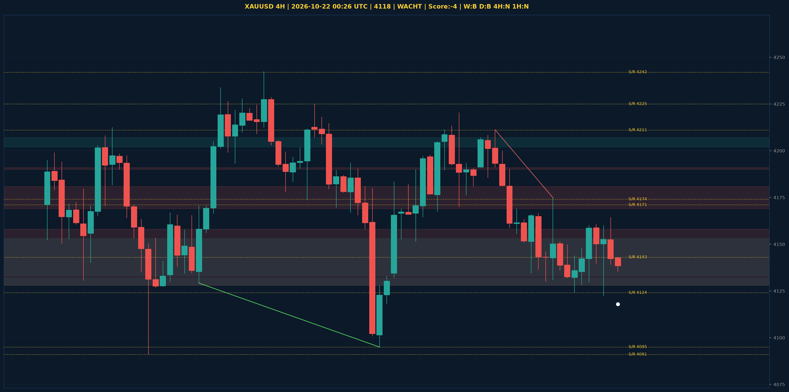

# XAUUSD Liquidity Sweep Analyse - 2026-10-22 00:26 UTC

> Prijs: 4118 | Beslissing: WACHT | Score: -4

---

## Liquidity Sweep

- **Manipulatie:** BEARISH @ 4143
- **5m reversal (BOS/iFVG):** bevestigd (iFVG: BEARISH)
- **1m entry trigger:** niet bevestigd
- **DXY 5m trend:** BEARISH | **Correlatie:** niet aligned
- **Draws on liquidity (highs):** [4143.0, 4164.0, 4175.0]
- **Draws on liquidity (lows):** [4122.0, 4135.0]

---

## Grafiek

---

## Top-Down Trend

| TF | Trend |
|---|---|
| Weekly | BEARISH |
| Daily | BEARISH |
| 4H | NEUTRAAL |
| 1H | NEUTRAAL |
| 30min | BEARISH |
| 5min | NEUTRAAL |

## Fibonacci (swing 3955 - 4755)

| Level | Prijs |
|---|---|
| 23.6% | 4566 |
| 38.2% | 4450 |
| 50.0% | 4355 |
| 61.8% | 4261 |
| 78.6% | 4127 |

## S/R

Daily: [4091.0, 4143.0, 4171.0, 4242.0, 4273.0, 4440.0, 4755.0]
4H: [4095.0, 4124.0, 4174.0, 4211.0, 4225.0]
1H: [4122.0, 4140.0, 4161.0, 4175.0]

*MVR Trading Agent | 2026-10-22 00:26 UTC*
