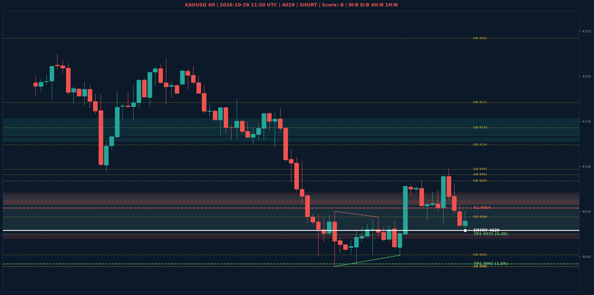

# XAUUSD Liquidity Sweep Analyse - 2026-10-29 11:50 UTC

> Prijs: 4029 | Beslissing: SHORT | Score: -8

---

## Liquidity Sweep

- **Manipulatie:** BEARISH @ 4051
- **5m reversal (BOS/iFVG):** bevestigd (iFVG: BEARISH)
- **1m entry trigger:** bevestigd
- **DXY 5m trend:** BULLISH | **Correlatie:** OK
- **Draws on liquidity (highs):** [4051.0, 4058.0, 4097.0]
- **Draws on liquidity (lows):** [4025.0, 4027.0, 4033.0]

---

## Grafiek

---

## Top-Down Trend

| TF | Trend |
|---|---|
| Weekly | BEARISH |
| Daily | BEARISH |
| 4H | NEUTRAAL |
| 1H | NEUTRAAL |
| 30min | BEARISH |
| 5min | BULLISH |

## Fibonacci (swing 3955 - 4755)

| Level | Prijs |
|---|---|
| 23.6% | 4566 |
| 38.2% | 4450 |
| 50.0% | 4355 |
| 61.8% | 4261 |
| 78.6% | 4127 |

## S/R

Daily: [3989.0, 4091.0, 4143.0, 4171.0, 4242.0, 4440.0, 4755.0]
4H: [3989.0, 4002.0, 4044.0, 4084.0, 4097.0, 4124.0]
1H: [4027.0, 4040.0, 4072.0, 4097.0]

## Trade Setup

| | |
|---|---|
| Entry | 4029 |
| Stop Loss | 4054 |
| TP1 | 3992 (1.5R) |
| TP2 | 4025 (0.2R) |

*MVR Trading Agent | 2026-10-29 11:50 UTC*
