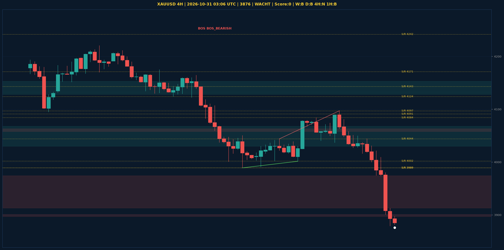

# XAUUSD Liquidity Sweep Analyse - 2026-10-31 03:06 UTC

> Prijs: 3876 | Beslissing: WACHT | Score: 0

---

## Liquidity Sweep

- **Manipulatie:** geen sweep gedetecteerd
- **5m reversal (BOS/iFVG):** niet bevestigd (iFVG: geen)
- **1m entry trigger:** niet bevestigd
- **DXY 5m trend:** NEUTRAAL | **Correlatie:** niet aligned
- **Draws on liquidity (highs):** [4044.0, 4081.0]
- **Draws on liquidity (lows):** [3879.0]

---

## Grafiek

---

## Top-Down Trend

| TF | Trend |
|---|---|
| Weekly | BEARISH |
| Daily | BEARISH |
| 4H | NEUTRAAL |
| 1H | BEARISH |
| 30min | BEARISH |
| 5min | NEUTRAAL |

## Fibonacci (swing 3879 - 4755)

| Level | Prijs |
|---|---|
| 23.6% | 4548 |
| 38.2% | 4420 |
| 50.0% | 4317 |
| 61.8% | 4214 |
| 78.6% | 4067 |

## S/R

Daily: [3989.0, 4091.0, 4143.0, 4171.0, 4242.0, 4440.0, 4755.0]
4H: [3989.0, 4002.0, 4044.0, 4084.0, 4097.0, 4124.0]
1H: [3975.0, 4016.0, 4044.0, 4074.0, 4097.0]

*MVR Trading Agent | 2026-10-31 03:06 UTC*
