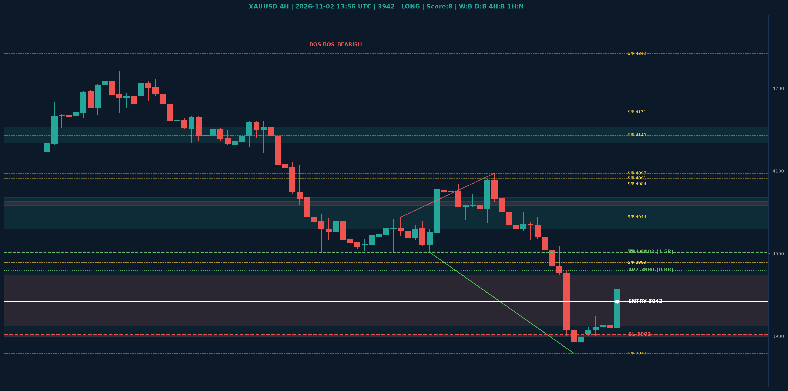

# XAUUSD Liquidity Sweep Analyse - 2026-11-02 13:56 UTC

> Prijs: 3942 | Beslissing: LONG | Score: 8

---

## Liquidity Sweep

- **Manipulatie:** BULLISH @ 3906
- **5m reversal (BOS/iFVG):** bevestigd (iFVG: BULLISH)
- **1m entry trigger:** bevestigd
- **DXY 5m trend:** BEARISH | **Correlatie:** OK
- **Draws on liquidity (highs):** [3916.0, 3928.0, 3961.0, 3980.0, 4044.0]
- **Draws on liquidity (lows):** [3879.0, 3900.0, 3905.0, 3906.0]

---

## Grafiek

---

## Top-Down Trend

| TF | Trend |
|---|---|
| Weekly | BEARISH |
| Daily | BEARISH |
| 4H | BEARISH |
| 1H | NEUTRAAL |
| 30min | BULLISH |
| 5min | BEARISH |

## Fibonacci (swing 3879 - 4755)

| Level | Prijs |
|---|---|
| 23.6% | 4548 |
| 38.2% | 4420 |
| 50.0% | 4317 |
| 61.8% | 4214 |
| 78.6% | 4067 |

## S/R

Daily: [3989.0, 4091.0, 4143.0, 4171.0, 4242.0, 4440.0, 4755.0]
4H: [3879.0, 3989.0, 4002.0, 4044.0, 4084.0, 4097.0]
1H: [3879.0, 3900.0, 3924.0, 3975.0, 4016.0, 4044.0]

## Trade Setup

| | |
|---|---|
| Entry | 3942 |
| Stop Loss | 3902 |
| TP1 | 4002 (1.5R) |
| TP2 | 3980 (0.9R) |

*MVR Trading Agent | 2026-11-02 13:56 UTC*
