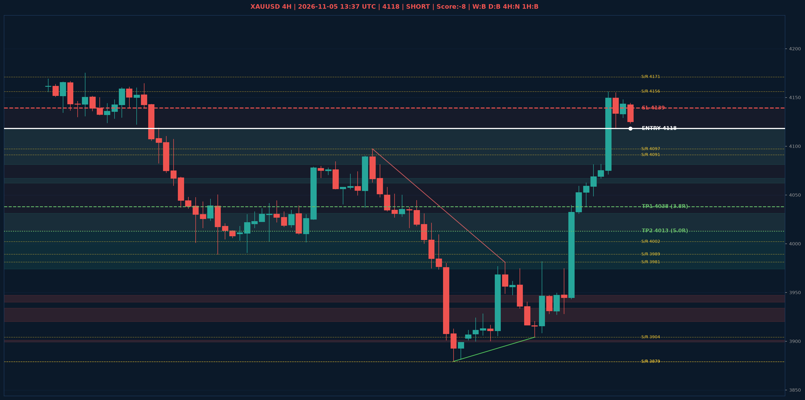

# XAUUSD Liquidity Sweep Analyse - 2026-11-05 13:37 UTC

> Prijs: 4118 | Beslissing: SHORT | Score: -8

---

## Liquidity Sweep

- **Manipulatie:** BEARISH @ 4134
- **5m reversal (BOS/iFVG):** bevestigd (iFVG: BEARISH)
- **1m entry trigger:** bevestigd
- **DXY 5m trend:** BULLISH | **Correlatie:** OK
- **Draws on liquidity (highs):** [4134.0, 4148.0, 4150.0, 4156.0]
- **Draws on liquidity (lows):** [3927.0, 4038.0, 4118.0, 4123.0, 4126.0]

---

## Grafiek

---

## Top-Down Trend

| TF | Trend |
|---|---|
| Weekly | BEARISH |
| Daily | BEARISH |
| 4H | NEUTRAAL |
| 1H | BULLISH |
| 30min | BULLISH |
| 5min | BEARISH |

## Fibonacci (swing 3879 - 4755)

| Level | Prijs |
|---|---|
| 23.6% | 4548 |
| 38.2% | 4420 |
| 50.0% | 4317 |
| 61.8% | 4214 |
| 78.6% | 4067 |

## S/R

Daily: [3879.0, 3989.0, 4091.0, 4171.0, 4242.0, 4440.0, 4755.0]
4H: [3879.0, 3904.0, 3981.0, 4002.0, 4097.0, 4156.0]
1H: [3904.0, 3927.0, 3974.0, 4038.0, 4062.0, 4081.0, 4118.0, 4156.0]

## Trade Setup

| | |
|---|---|
| Entry | 4118 |
| Stop Loss | 4139 |
| TP1 | 4038 (3.8R) |
| TP2 | 4013 (5.0R) |

*MVR Trading Agent | 2026-11-05 13:37 UTC*
