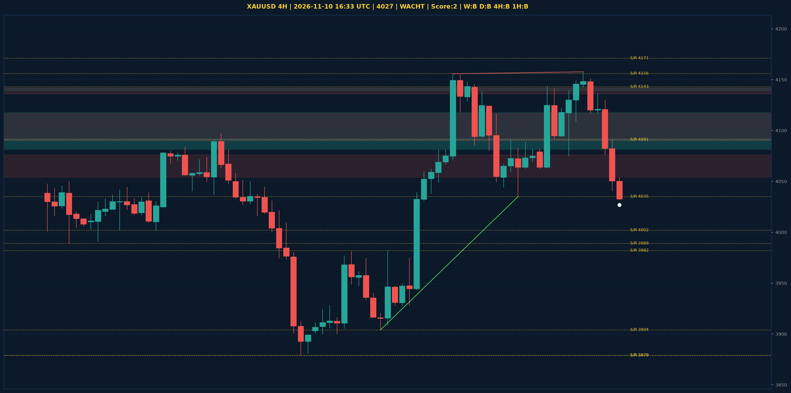

# XAUUSD Liquidity Sweep Analyse - 2026-11-10 16:33 UTC

> Prijs: 4027 | Beslissing: WACHT | Score: 2

---

## Liquidity Sweep

- **Manipulatie:** BULLISH @ 4032
- **5m reversal (BOS/iFVG):** niet bevestigd (iFVG: BEARISH)
- **1m entry trigger:** niet bevestigd
- **DXY 5m trend:** BULLISH | **Correlatie:** niet aligned
- **Draws on liquidity (highs):** [4090.0, 4130.0, 4136.0, 4158.0]
- **Draws on liquidity (lows):** [4032.0, 4076.0, 4119.0]

---

## Grafiek

---

## Top-Down Trend

| TF | Trend |
|---|---|
| Weekly | BEARISH |
| Daily | BEARISH |
| 4H | BULLISH |
| 1H | BULLISH |
| 30min | NEUTRAAL |
| 5min | BEARISH |

## Fibonacci (swing 3879 - 4755)

| Level | Prijs |
|---|---|
| 23.6% | 4548 |
| 38.2% | 4420 |
| 50.0% | 4317 |
| 61.8% | 4214 |
| 78.6% | 4067 |

## S/R

Daily: [3879.0, 3989.0, 4091.0, 4171.0, 4242.0, 4440.0, 4755.0]
4H: [3879.0, 3904.0, 3982.0, 4002.0, 4035.0, 4143.0, 4156.0]
1H: [4062.0, 4075.0, 4088.0, 4117.0, 4143.0, 4158.0]

*MVR Trading Agent | 2026-11-10 16:33 UTC*
