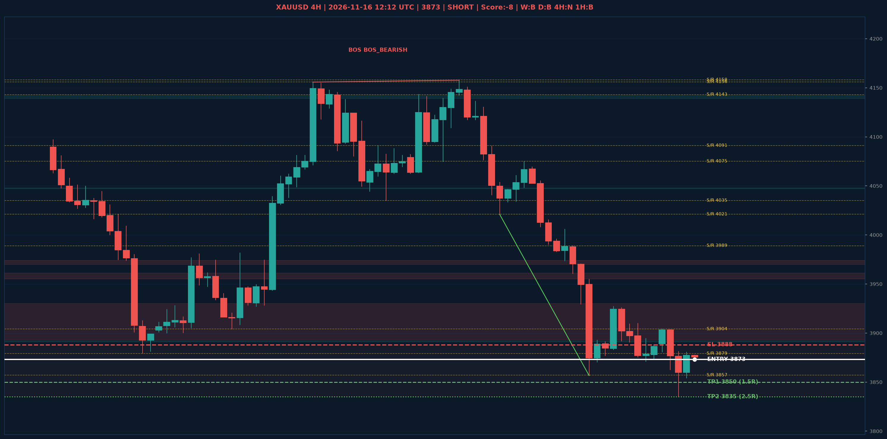

# XAUUSD Liquidity Sweep Analyse - 2026-11-16 12:12 UTC

> Prijs: 3873 | Beslissing: SHORT | Score: -8

---

## Liquidity Sweep

- **Manipulatie:** BEARISH @ 3880
- **5m reversal (BOS/iFVG):** bevestigd (iFVG: BEARISH)
- **1m entry trigger:** bevestigd
- **DXY 5m trend:** BULLISH | **Correlatie:** OK
- **Draws on liquidity (highs):** [3880.0, 3881.0, 3910.0, 3927.0]
- **Draws on liquidity (lows):** [3835.0, 3854.0]

---

## Grafiek

---

## Top-Down Trend

| TF | Trend |
|---|---|
| Weekly | BEARISH |
| Daily | BEARISH |
| 4H | NEUTRAAL |
| 1H | BEARISH |
| 30min | BEARISH |
| 5min | NEUTRAAL |

## Fibonacci (swing 3835 - 4755)

| Level | Prijs |
|---|---|
| 23.6% | 4538 |
| 38.2% | 4404 |
| 50.0% | 4295 |
| 61.8% | 4187 |
| 78.6% | 4032 |

## S/R

Daily: [3879.0, 3989.0, 4091.0, 4158.0, 4242.0, 4440.0, 4755.0]
4H: [3857.0, 3904.0, 4021.0, 4035.0, 4075.0, 4143.0, 4156.0]
1H: [3835.0, 3862.0, 3892.0, 3904.0, 3927.0]

## Trade Setup

| | |
|---|---|
| Entry | 3873 |
| Stop Loss | 3888 |
| TP1 | 3850 (1.5R) |
| TP2 | 3835 (2.5R) |

*MVR Trading Agent | 2026-11-16 12:12 UTC*
