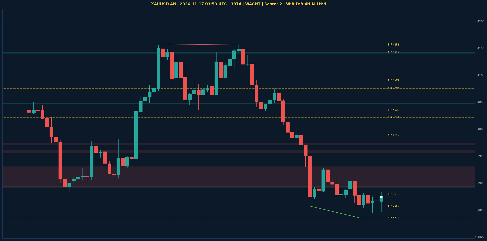

# XAUUSD Liquidity Sweep Analyse - 2026-11-17 03:59 UTC

> Prijs: 3874 | Beslissing: WACHT | Score: -2

---

## Liquidity Sweep

- **Manipulatie:** BEARISH @ 3882
- **5m reversal (BOS/iFVG):** niet bevestigd (iFVG: BULLISH)
- **1m entry trigger:** niet bevestigd
- **DXY 5m trend:** NEUTRAAL | **Correlatie:** niet aligned
- **Draws on liquidity (highs):** [3882.0, 3893.0, 3910.0]
- **Draws on liquidity (lows):** [3835.0, 3846.0]

---

## Grafiek

---

## Top-Down Trend

| TF | Trend |
|---|---|
| Weekly | BEARISH |
| Daily | BEARISH |
| 4H | NEUTRAAL |
| 1H | NEUTRAAL |
| 30min | BULLISH |
| 5min | BULLISH |

## Fibonacci (swing 3846 - 4755)

| Level | Prijs |
|---|---|
| 23.6% | 4540 |
| 38.2% | 4408 |
| 50.0% | 4300 |
| 61.8% | 4193 |
| 78.6% | 4040 |

## S/R

Daily: [3879.0, 3989.0, 4091.0, 4158.0, 4242.0, 4440.0, 4755.0]
4H: [3835.0, 3857.0, 4021.0, 4035.0, 4075.0, 4143.0, 4156.0]
1H: [3835.0, 3862.0, 3893.0, 3910.0, 3927.0]

*MVR Trading Agent | 2026-11-17 03:59 UTC*
