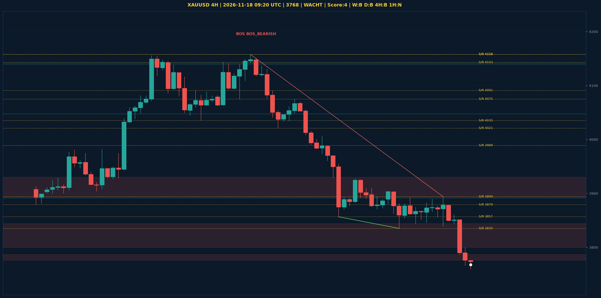

# XAUUSD Liquidity Sweep Analyse - 2026-11-18 09:20 UTC

> Prijs: 3768 | Beslissing: WACHT | Score: 4

---

## Liquidity Sweep

- **Manipulatie:** BULLISH @ 3760
- **5m reversal (BOS/iFVG):** bevestigd (iFVG: BULLISH)
- **1m entry trigger:** niet bevestigd
- **DXY 5m trend:** BULLISH | **Correlatie:** niet aligned
- **Draws on liquidity (highs):** [3776.0, 3800.0, 3894.0]
- **Draws on liquidity (lows):** [3760.0, 3766.0]

---

## Grafiek

---

## Top-Down Trend

| TF | Trend |
|---|---|
| Weekly | BEARISH |
| Daily | BEARISH |
| 4H | BEARISH |
| 1H | NEUTRAAL |
| 30min | BULLISH |
| 5min | BEARISH |

## Fibonacci (swing 3760 - 4755)

| Level | Prijs |
|---|---|
| 23.6% | 4520 |
| 38.2% | 4375 |
| 50.0% | 4257 |
| 61.8% | 4140 |
| 78.6% | 3973 |

## S/R

Daily: [3879.0, 3989.0, 4091.0, 4158.0, 4242.0, 4440.0, 4755.0]
4H: [3835.0, 3857.0, 3894.0, 4021.0, 4035.0, 4075.0, 4143.0, 4158.0]
1H: [3835.0, 3890.0, 3904.0]

*MVR Trading Agent | 2026-11-18 09:20 UTC*
