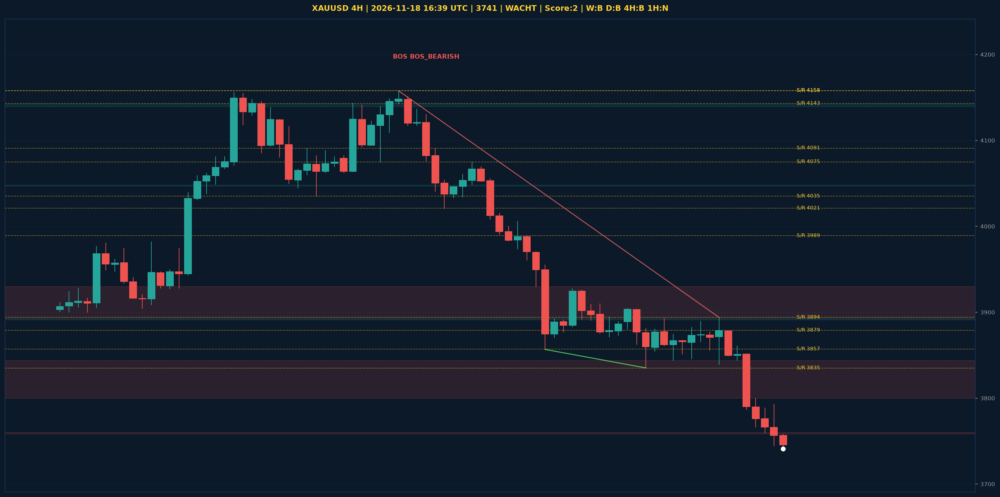

# XAUUSD Liquidity Sweep Analyse - 2026-11-18 16:39 UTC

> Prijs: 3741 | Beslissing: WACHT | Score: 2

---

## Liquidity Sweep

- **Manipulatie:** BULLISH @ 3741
- **5m reversal (BOS/iFVG):** niet bevestigd (iFVG: BEARISH)
- **1m entry trigger:** niet bevestigd
- **DXY 5m trend:** NEUTRAAL | **Correlatie:** niet aligned
- **Draws on liquidity (highs):** [3789.0, 3793.0, 3800.0, 3879.0, 3894.0]
- **Draws on liquidity (lows):** [3741.0, 3745.0, 3766.0]

---

## Grafiek

---

## Top-Down Trend

| TF | Trend |
|---|---|
| Weekly | BEARISH |
| Daily | BEARISH |
| 4H | BEARISH |
| 1H | NEUTRAAL |
| 30min | NEUTRAAL |
| 5min | NEUTRAAL |

## Fibonacci (swing 3741 - 4755)

| Level | Prijs |
|---|---|
| 23.6% | 4516 |
| 38.2% | 4368 |
| 50.0% | 4248 |
| 61.8% | 4128 |
| 78.6% | 3958 |

## S/R

Daily: [3879.0, 3989.0, 4091.0, 4158.0, 4242.0, 4440.0, 4755.0]
4H: [3835.0, 3857.0, 3894.0, 4021.0, 4035.0, 4075.0, 4143.0, 4158.0]
1H: [3745.0, 3760.0, 3793.0, 3839.0, 3890.0]

*MVR Trading Agent | 2026-11-18 16:39 UTC*
