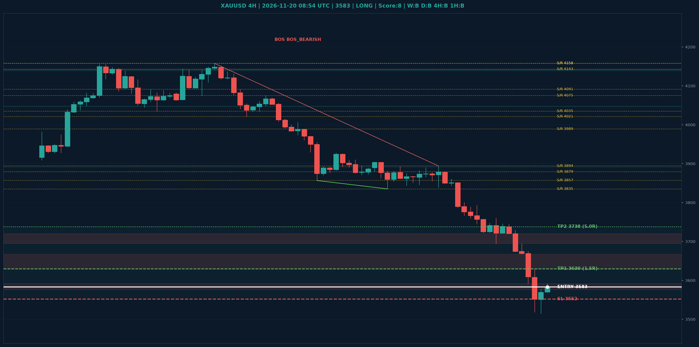

# XAUUSD Liquidity Sweep Analyse - 2026-11-20 08:54 UTC

> Prijs: 3583 | Beslissing: LONG | Score: 8

---

## Liquidity Sweep

- **Manipulatie:** BULLISH @ 3568
- **5m reversal (BOS/iFVG):** bevestigd (iFVG: BULLISH)
- **1m entry trigger:** bevestigd
- **DXY 5m trend:** BEARISH | **Correlatie:** OK
- **Draws on liquidity (highs):** [3576.0, 3592.0, 3742.0, 3793.0]
- **Draws on liquidity (lows):** [3515.0, 3568.0]

---

## Grafiek

---

## Top-Down Trend

| TF | Trend |
|---|---|
| Weekly | BEARISH |
| Daily | BEARISH |
| 4H | BEARISH |
| 1H | BEARISH |
| 30min | BEARISH |
| 5min | BEARISH |

## Fibonacci (swing 3515 - 4755)

| Level | Prijs |
|---|---|
| 23.6% | 4462 |
| 38.2% | 4281 |
| 50.0% | 4135 |
| 61.8% | 3989 |
| 78.6% | 3780 |

## S/R

Daily: [3879.0, 3989.0, 4091.0, 4158.0, 4242.0, 4440.0, 4755.0]
4H: [3835.0, 3857.0, 3894.0, 4021.0, 4035.0, 4075.0, 4143.0, 4158.0]
1H: [3515.0, 3694.0, 3722.0, 3745.0, 3760.0, 3793.0, 3890.0]

## Trade Setup

| | |
|---|---|
| Entry | 3583 |
| Stop Loss | 3552 |
| TP1 | 3630 (1.5R) |
| TP2 | 3738 (5.0R) |

*MVR Trading Agent | 2026-11-20 08:54 UTC*
