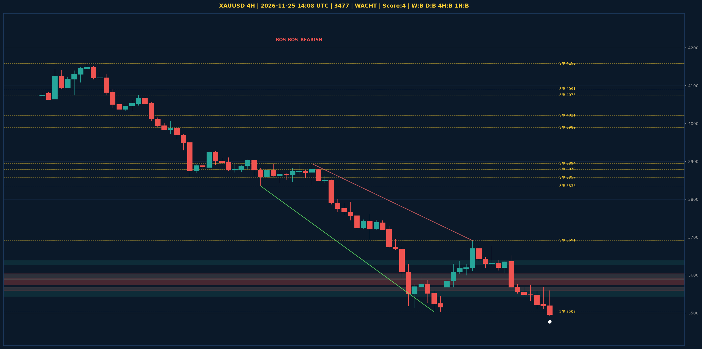

# XAUUSD Liquidity Sweep Analyse - 2026-11-25 14:08 UTC

> Prijs: 3477 | Beslissing: WACHT | Score: 4

---

## Liquidity Sweep

- **Manipulatie:** BULLISH @ 3494
- **5m reversal (BOS/iFVG):** niet bevestigd (iFVG: BEARISH)
- **1m entry trigger:** niet bevestigd
- **DXY 5m trend:** BEARISH | **Correlatie:** OK
- **Draws on liquidity (highs):** [3550.0, 3551.0, 3567.0, 3641.0, 3677.0]
- **Draws on liquidity (lows):** [3494.0, 3511.0, 3512.0]

---

## Grafiek

---

## Top-Down Trend

| TF | Trend |
|---|---|
| Weekly | BEARISH |
| Daily | BEARISH |
| 4H | BEARISH |
| 1H | BEARISH |
| 30min | BEARISH |
| 5min | BEARISH |

## Fibonacci (swing 3496 - 4755)

| Level | Prijs |
|---|---|
| 23.6% | 4458 |
| 38.2% | 4274 |
| 50.0% | 4125 |
| 61.8% | 3977 |
| 78.6% | 3765 |

## S/R

Daily: [3879.0, 3989.0, 4091.0, 4158.0, 4242.0, 4440.0, 4755.0]
4H: [3503.0, 3691.0, 3835.0, 3857.0, 3894.0, 4021.0, 4075.0, 4158.0]
1H: [3511.0, 3532.0, 3567.0, 3606.0, 3618.0, 3651.0, 3677.0]

*MVR Trading Agent | 2026-11-25 14:08 UTC*
